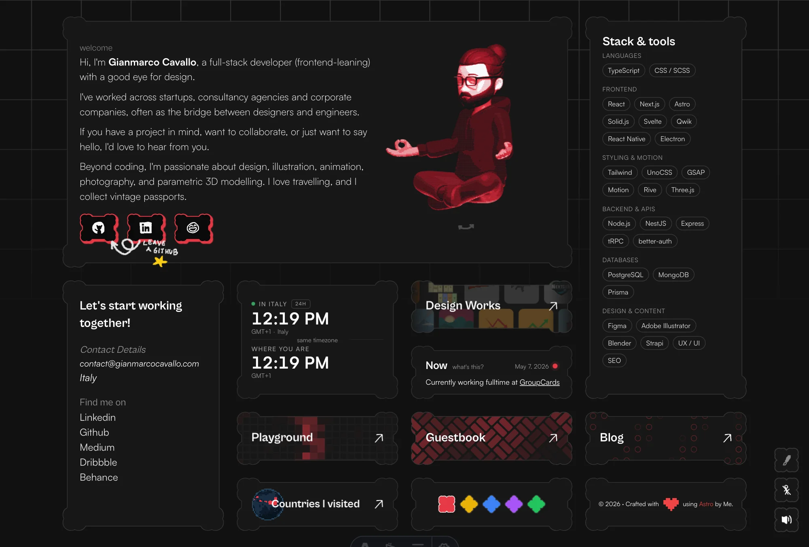

#  Visual Identity

A modern, interactive bento-style studio and personal showcase website built with **[Astro](https://astro.build)**.



**Live Website:** [visualidentity.com](https://visualidentity.com/)  
**Brand:** **Visual Identity** — Creative Design & Digital Experience Studio

---

## Overview

**Visual Identity** is an interactive, bento-grid website engineered to showcase digital craftsmanship, design systems, interactive experiments, and creative direction. Built with modern performance standards in mind, it combines server-side rendering (SSR), reactive UI islands, dynamic theme switching, 3D datavisualization, and audio micro-interactions.

---

## Features

-  **Bento-Grid Architecture** — Sleek, modular, responsive single-page grid highlighting brand identity, work, and capabilities.
-  **Dynamic Multi-Theme System** — Switchable visual aesthetic modes (Glass, Sharp, Neon, and Paper styles) with custom color accents and sound cues.
-  **Comprehensive Contact Hub** — Direct contact details featuring **Primary Email** (`contact@visualidentity.com`) alongside an **Alternative Email** (`hello@visualidentity.com`), global location indicator, and social profiles.
-  **Interactive 3D Globe & Travel Map** — D3-driven rotating globe and travel log visualizing global presence and visited countries.
-  **Interactive Playground** — Showcase of advanced animations and interactions including GSAP morphs, Rive runtime animations, and physics-based motion.
-  **Markdown Blog & RSS** — Technical & creative blog posts with reading-time estimates, syntax highlighting, and an automated RSS feed (`/rss.xml`).
-  **Live Guestbook** — Community guestbook allowing visitors to leave comments and hearts, backed by Drizzle ORM and libSQL.
-  **UI Micro-Sounds** — Optional, toggleable subtle spatial audio effects enhancing tactile user interactions.
-  **SEO & OpenGraph Optimized** — Structured data (Schema.org JSON-LD), dynamic OpenGraph social cards, sitemap, and robots.txt.
-  **Edge & Cloud Deployment** — Production-ready SSR deployment configured for [Netlify](https://www.netlify.com/).

---

## Tech Stack

| Domain | Technologies |
| :--- | :--- |
| **Core Framework** | [Astro](https://astro.build) (SSR & Island Architecture) |
| **Styling & Design System** | [UnoCSS](https://unocss.dev/), Custom Nine-Slice Frames, CSS Variables |
| **Interactive Islands** | [SolidJS](https://www.solidjs.com/), [Svelte 5](https://svelte.dev/) |
| **Animation & Motion** | [Motion](https://motion.dev/), [GSAP](https://gsap.com/), [Lenis](https://lenis.darkroom.engineering/), [Rive](https://rive.app/) |
| **Dataviz & 3D** | [Three.js](https://threejs.org/), [D3.js](https://d3js.org/) (D3-Geo & D3-Drag) |
| **Database & ORM** | [Drizzle ORM](https://orm.drizzle.team/) with [libSQL / Turso](https://turso.tech/) (Guestbook) |
| **Hosting & Edge** | [Netlify Edge Adapter](https://docs.astro.build/en/guides/integrations-guide/netlify/) |

---

## Contact Information

| Type | Detail |
| :--- | :--- |
| **Brand Name** | **Visual Identity** |
| **Primary Email** | [`contact@visualidentity.com`](mailto:contact@visualidentity.com) |
| **Alternative Email** | [`hello@visualidentity.com`](mailto:hello@visualidentity.com) |
| **Location** | Remote / Worldwide |
| **GitHub** | [github.com/visualidentity](https://github.com/visualidentity) |
| **LinkedIn** | [linkedin.com/company/visual-identity](https://www.linkedin.com/company/visual-identity) |
| **Dribbble** | [dribbble.com/visualidentity](https://dribbble.com/visualidentity) |
| **Behance** | [behance.net/visualidentity](https://www.behance.net/visualidentity) |
| **Medium** | [medium.com/@visualidentity](https://medium.com/@visualidentity) |

---

## Project Structure

```text
Visual-Identity/
├── public/                 # Static assets, manifests, favicons, preview images
│   ├── site.webmanifest    # Web app manifest with Visual Identity branding
│   └── preview.webp        # Website showcase preview
├── scripts/                # Utility & configuration automation scripts
│   ├── setup.mjs           # Interactive configuration wizard
│   └── make-icons.mjs      # Pixel icon & favicon generator
├── src/
│   ├── assets/             # Brand fonts (Cabinet Grotesk, Satoshi) and sprites
│   ├── components/         # Bento cards & interactive UI components
│   │   ├── AboutMe.astro   # Studio tech stack & toolset breakdown
│   │   ├── ContactsCard.astro # Primary & alternative contact details & links
│   │   ├── DesignWorksCard.astro # Animated marquee of visual design projects
│   │   ├── Globe.tsx       # Interactive 3D D3 globe component
│   │   ├── IntroCard.astro # Welcome card with interactive rotating avatar
│   │   ├── Now.astro       # Current status and active engagements
│   │   ├── ThemeChangeCard.astro # Multi-theme switcher
│   │   └── TimeZoneCard.astro # Live local & visitor timezone calculator
│   ├── layouts/
│   │   ├── BasicLayout.astro # Base HTML, OpenGraph, Schema.org, SEO headers
│   │   └── Layout.astro    # Common page wrapper
│   ├── lib/                # Database clients, animations, and helper utilities
│   ├── pages/              # Astro file-based routes
│   │   ├── index.astro     # Main bento homepage
│   │   ├── blog/           # Markdown-driven blog
│   │   ├── guestbook.astro # LibSQL interactive guestbook
│   │   ├── playground/     # Creative animation experiments
│   │   ├── travel.astro    # Interactive world map
│   │   ├── design-works.astro # Showcase of visual design projects
│   │   └── rss.xml.js      # Blog RSS feed generator
│   └── site-config.ts      # Central configuration for brand, metadata, and contacts
├── astro.config.mjs        # Astro configuration with integrations & SSR adapter
├── package.json            # Dependencies and npm scripts
└── uno.config.ts           # UnoCSS configuration and theme rules
```

---

## Getting Started

### Prerequisites

- **Node.js** `24.13.0` or higher (see [`.nvmrc`](.nvmrc) — run `nvm use`)
- **pnpm** `pnpm@10` is recommended (`npm install -g pnpm`)

### Installation

1. **Clone the repository:**
   ```bash
   git clone https://github.com/visualidentity/visual-identity.git
   cd visual-identity
   ```

2. **Install project dependencies:**
   ```bash
   pnpm install
   ```

3. **Start the local development server:**
   ```bash
   pnpm dev
   ```
   Open [http://localhost:4321](http://localhost:4321) in your browser to view the site.

---

## Customization

### 1. Site Configuration & Contact Details
All branding, metadata, and contact details are centrally configured in [`src/site-config.ts`](file:///c:/Users/QBS%20Accounting/Documents/websites/Visual-Identity/src/site-config.ts):

```typescript
export const DOMAIN = "visualidentity.com";

export const SITE = {
  site: {
    domain: DOMAIN,
    url: `https://${DOMAIN}/`,
  },
  brand: {
    name: "Visual Identity",
    tagline: "Creative Design & Digital Experiences",
  },
  author: {
    fullName: "Visual Identity",
    jobTitle: "Creative Design & Development Studio",
    // ...
  },
  links: {
    email: "contact@visualidentity.com",           // Primary Email
    alternativeEmail: "hello@visualidentity.com", // Alternative Email
    github: "https://github.com/visualidentity",
    linkedin: "https://www.linkedin.com/company/visual-identity",
    // ...
  },
};
```

### 2. Interactive Setup Wizard
You can quickly customize or update site parameters using the built-in interactive CLI:

```bash
pnpm site-setup
```

---

## Available Scripts

| Command | Description |
| :--- | :--- |
| `pnpm dev` | Starts the Astro development server at `http://localhost:4321` |
| `pnpm build` | Compiles the production application with SSR bundle |
| `pnpm preview` | Runs the production build locally for verification |
| `pnpm check` | Runs Astro and TypeScript type-checking (`astro check`) |
| `pnpm eslint` | Lints JavaScript and Astro source files |
| `pnpm format` | Formats all code according to Prettier guidelines |
| `pnpm site-setup` | Runs the terminal configuration wizard |

---

## Database Setup (Guestbook)

The guestbook uses [Drizzle ORM](https://orm.drizzle.team/) with a [Turso / libSQL](https://turso.tech/) remote database.

1. **Create your database on Turso** and add credentials to `.env`:
   ```bash
   TURSO_DATABASE_URL=libsql://<your-database>.turso.io
   TURSO_AUTH_TOKEN=<your-auth-token>
   ```

2. **Execute the schema migration:**
   ```sql
   CREATE TABLE "Guestbook" (
     "id" integer PRIMARY KEY,
     "name" text NOT NULL,
     "message" text NOT NULL,
     "website" text,
     "parentId" integer,
     "heartCount" integer,
     "createdAt" text NOT NULL
   );
   ```

> *Note: If you do not require a guestbook, you can safely remove `src/pages/guestbook.astro` and `src/pages/api/guestbook.ts`.*

---

## Deployment

### Deploying on Netlify

This project includes the official `@astrojs/netlify` edge adapter configured in `astro.config.mjs`.

1. Push your repository to GitHub / GitLab.
2. Link the repository in the [Netlify Dashboard](https://app.netlify.com/).
3. Add any required environment variables (`TURSO_DATABASE_URL`, `TURSO_AUTH_TOKEN`, `SITE_URL`).
4. Trigger build & deploy!

---

## License

Released under the [MIT License](LICENSE).

---

## Brand & Credits

**Visual Identity** — [visualidentity.com](https://visualidentity.com/)  
*Crafted with passion using [Astro](https://astro.build).*
